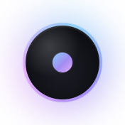
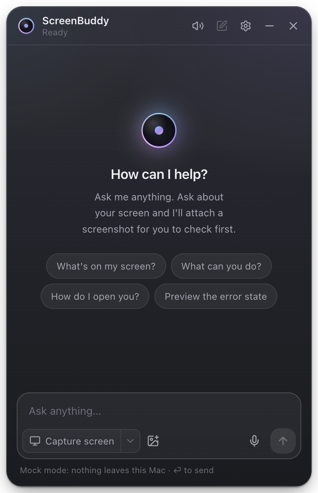
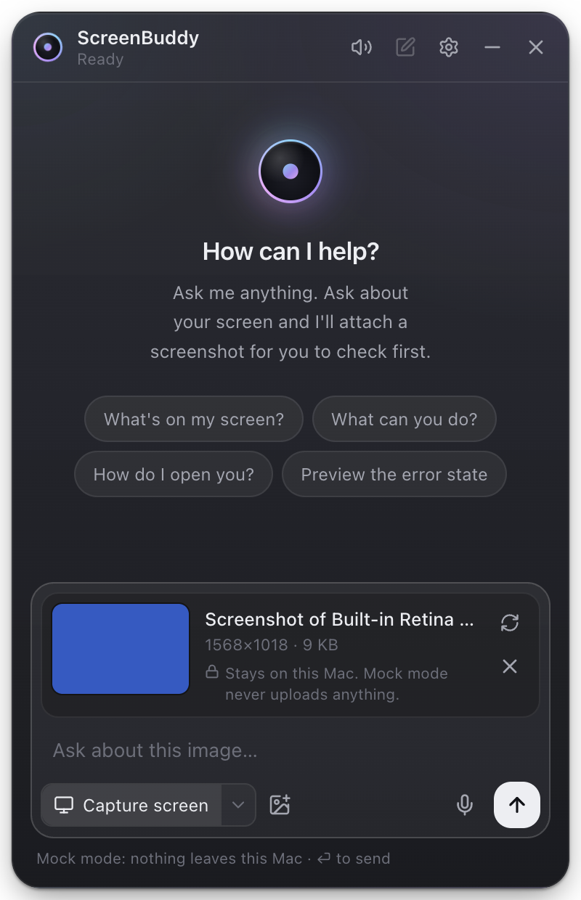
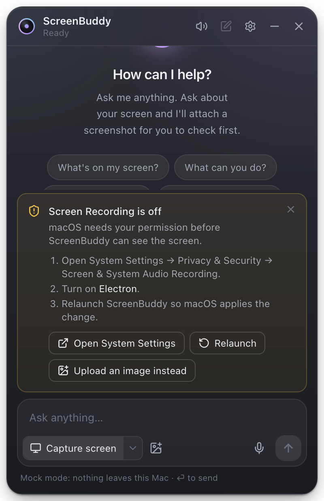
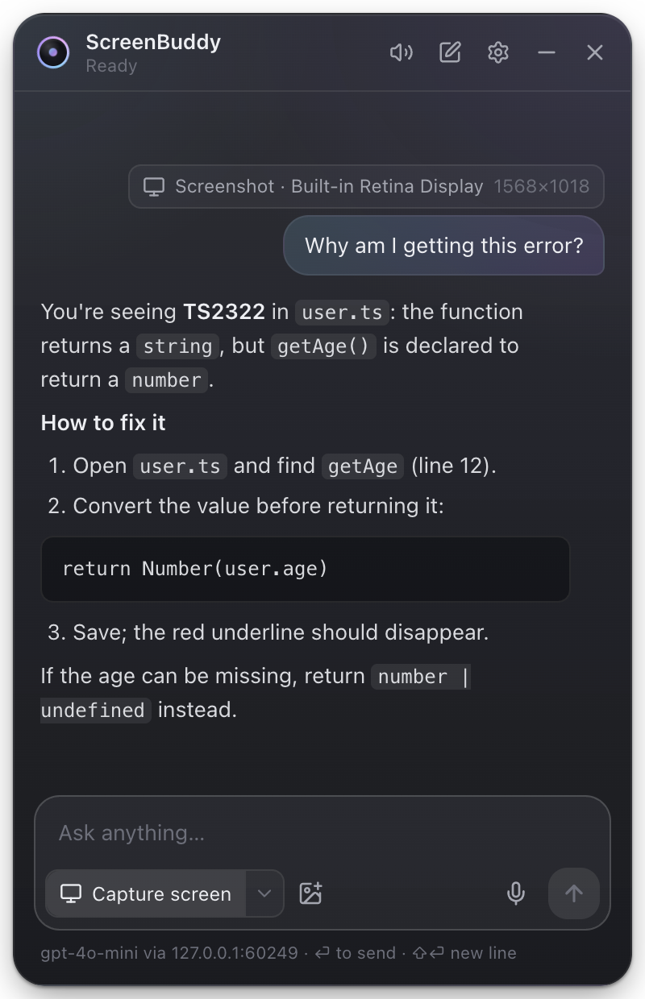
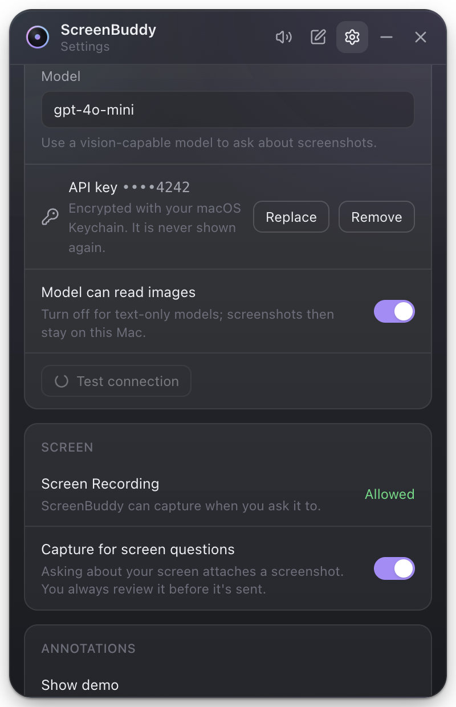
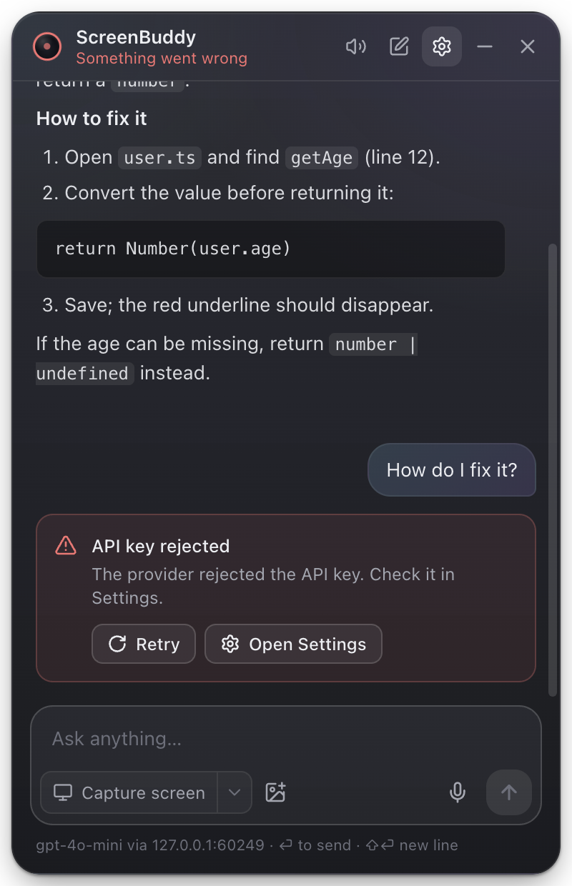
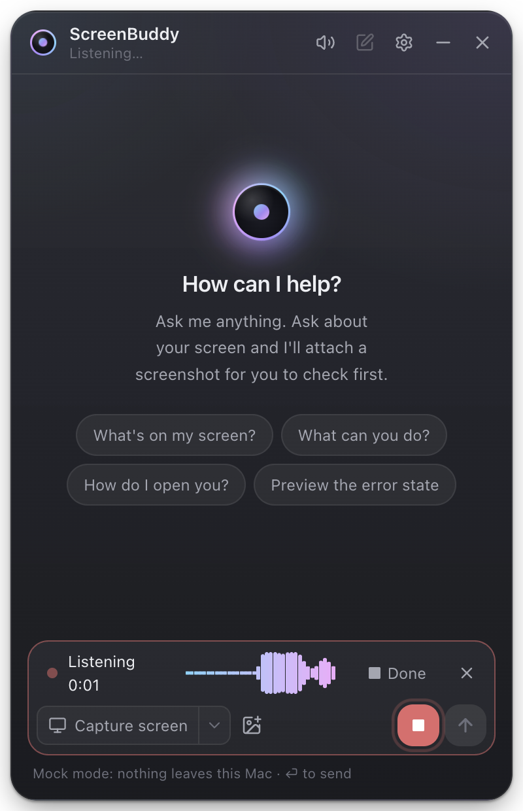
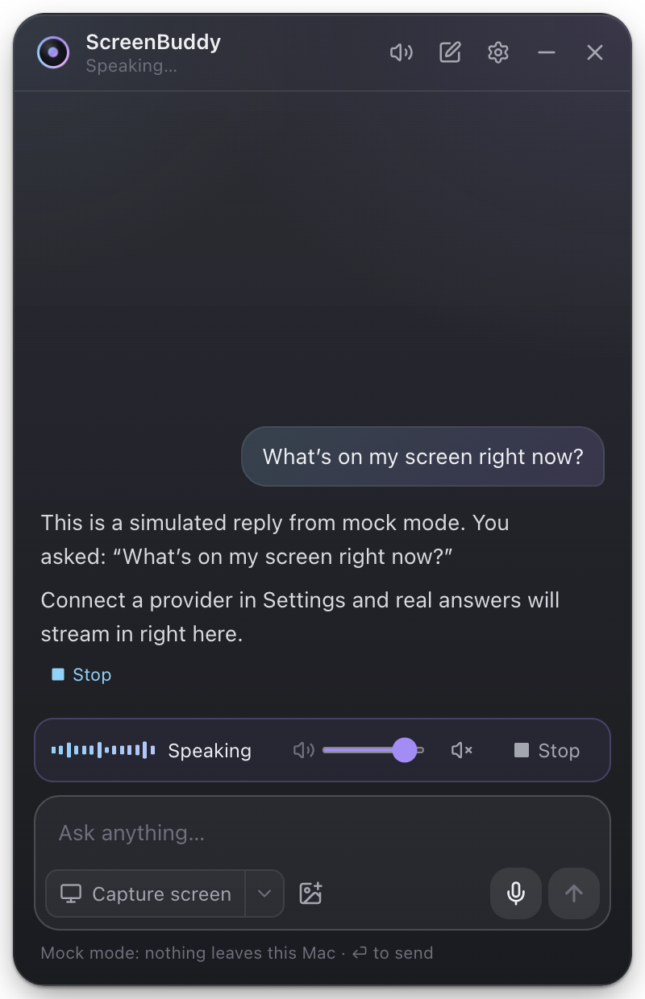
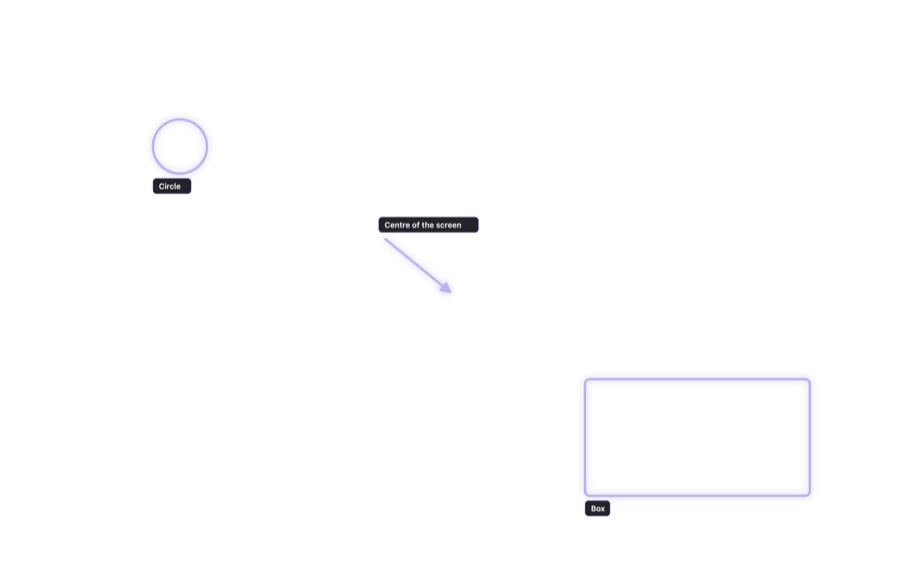

# ScreenBuddy

ScreenBuddy is a floating desktop assistant for macOS. You can ask it about whatever is on your screen, by typing or by speaking, and it answers in text or speech. When you ask about the screen, it takes a screenshot only after you ask. You review the screenshot, then send it with your question to an AI model you choose. The model can point at things on screen with arrows, circles and boxes.

It is an independent college project inspired by HeyClicky. It uses no HeyClicky code, assets or APIs.

> **Platform:** macOS on Apple Silicon. Developed and tested on macOS 26.6.2 (arm64) with Node 22.23.2. Other platforms are untested.

## Problem statement

When someone is stuck in an app, for example on a confusing settings page or a compiler error, getting help usually means describing the screen in words, or taking a screenshot, switching to a chatbot, pasting it in and typing the question. That is slow, and it leaks context: people paste whole screenshots, including private information, without thinking about it.

ScreenBuddy puts that loop in one place: a small assistant that is always one shortcut away, can see the screen _only when you ask_, shows you exactly what it will send, and can answer by voice and point at the right spot.

## Features actually implemented

Each item below is implemented and covered by automated tests (see [docs/TEST_REPORT.md](docs/TEST_REPORT.md)). Some parts have **not** been verified with real hardware or a real paid AI provider; see "Known gaps".

**Floating assistant**

- A frameless, transparent, always-on-top window. It shows as a small orb and expands into a chat panel.
- A global shortcut, **⌘⇧Space**, shows and hides it. A menu-bar (tray) icon offers Show/Hide, New Chat, Settings and Quit. There is no Dock icon by default.
- You can drag the orb or the panel header, and the position is remembered between launches.
- Esc hides the window, Minimize collapses it to the orb, and closing it keeps the app running in the menu bar.

**Screen capture**

- A **Capture screen** button captures the display ScreenBuddy is on. A display picker supports multiple monitors.
- Captures are taken at native (Retina) resolution, then scaled down for the model.
- Questions that clearly ask about the screen ("what's on my screen?") attach a screenshot automatically, but for **review only**: you press Send again to share it.
- A preview with enlarge, retake and remove. Before you send, it says plainly where the image will go.
- ScreenBuddy's own window is made invisible during the capture.
- When Screen Recording permission is missing, step-by-step guidance appears, along with an **upload an image** fallback (PNG/JPEG, checked by file content).
- Images are kept in memory only, and freed after the request, on new chat, on hide and on quit.

**AI conversation**

- Any OpenAI-compatible `/chat/completions` API (OpenAI, OpenRouter, Ollama, LM Studio, …). The base URL, model and API key are set in Settings, with a **Test connection** button.
- **Mock mode** is the default: simulated answers with no account, no network and no cost.
- Answers stream word by word and are rendered as Markdown. You can stop an answer, ask follow-ups in the same conversation (with compact context), retry, and get clear errors for an invalid key, an unreachable provider, a model without image support, timeouts and rate limits.
- The API key is encrypted with the macOS Keychain (Electron `safeStorage`) and never reaches the UI process.
- Chat history is kept in memory only, unless you opt in to saving the conversation's _text_ (never images).

**Voice**

- Click the microphone to talk, and click again (or pause) to stop. A red recording indicator with a live level meter shows while it's on.
- The microphone is opened only on that click. Silence is never sent. Recordings are never saved.
- Transcription uses the provider's `/audio/transcriptions`, or a free mock. You can edit the transcript before sending, or turn on auto-send.
- Answers to spoken questions are read aloud with the macOS system voice (or the provider's voice). There are stop, mute, volume and replay controls, and speech is interrupted when you start talking.
- A text-only mode removes the microphone.

**Screen annotations (MVP)**

- A transparent, click-through, always-on-top overlay draws **arrows, circles and rectangles** with short labels.
- The model can return normalized (0–1) coordinates in its answer. These are mapped onto the display the screenshot came from.
- Annotations stay for a configurable 4–60 s. **Clear annotations** (or Esc) removes them, and **Settings → Annotations → Demo** draws a fixed set without any model.

## Technology stack

| Area                 | Choice (exact versions are pinned in `package.json`)                                                                              |
| -------------------- | --------------------------------------------------------------------------------------------------------------------------------- |
| Desktop shell        | Electron 44.9.3, built with electron-vite 5 and Vite 7                                                                            |
| Language             | TypeScript 5.9 (`strict`, `noUncheckedIndexedAccess`, `exactOptionalPropertyTypes`)                                               |
| UI                   | React 19, Tailwind CSS 4, Motion 14, Lucide icons, react-markdown + remark-gfm                                                    |
| State and validation | Zustand (UI state), zod (every IPC message and settings file)                                                                     |
| AI and voice         | OpenAI-compatible HTTP APIs via Electron `net.fetch`, with our own streaming (SSE) parser; `speechSynthesis` for the system voice |
| Tests                | Vitest (unit, Node and jsdom), Playwright driving the real Electron app (E2E)                                                     |
| Quality              | ESLint (typescript-eslint, strict, type-checked), Prettier                                                                        |

The architecture is described in [docs/ARCHITECTURE.md](docs/ARCHITECTURE.md), and the security design in [docs/SECURITY.md](docs/SECURITY.md). Every design decision is logged in [docs/DECISIONS.md](docs/DECISIONS.md). The full write-up is in [docs/PROJECT_REPORT.md](docs/PROJECT_REPORT.md), and the live demo plan is in [docs/DEMO_SCRIPT.md](docs/DEMO_SCRIPT.md).

## Install from the DMG

1. Open `ScreenBuddy-0.1.0-arm64.dmg` and drag **ScreenBuddy** into **Applications**.
2. First launch: the app is ad-hoc signed and **not notarized** (there's no Apple Developer certificate), so macOS blocks it. Open it once, then go to **System Settings → Privacy & Security** and click **Open Anyway** next to the ScreenBuddy message. (Or, in Terminal: `xattr -dr com.apple.quarantine /Applications/ScreenBuddy.app`.)
3. The orb appears in the bottom-right corner, and an icon appears in the menu bar. There's no Dock icon.

The installed app asks for permissions as **ScreenBuddy**, unlike `npm run dev`, which asks as "Electron".

**Building the DMG yourself:** `npm run dist` writes `dist/ScreenBuddy-<version>-arm64.dmg`. If the project is in an iCloud-synced folder (Desktop or Documents), code signing fails with _"resource fork, Finder information, or similar detritus not allowed"_. In that case build outside the synced folder:

```sh
npx electron-vite build
CSC_IDENTITY_AUTO_DISCOVERY=false npx electron-builder --mac dmg --arm64 -c.directories.output="$HOME/Library/Caches/screenbuddy-build"
```

## Setup

Requirements: macOS on Apple Silicon, Node.js 22.12 or newer, and npm.

```sh
npm install
```

Installing from the committed lockfile works with npm 10 or 11. To _add_ a dependency, use `npx npm@11 install <pkg>`: npm 10.9 crashes resolving this dependency tree from scratch (see the test report).

## How to run

```sh
npm run dev
```

A small orb appears in the bottom-right corner, and an icon appears in the menu bar. Click the orb or press **⌘⇧Space** to open the chat. ScreenBuddy starts in **mock mode**.

**Connecting a real AI provider (optional):** Settings (⚙) → AI → **AI provider**, then pick a preset or enter:

| Provider       | Base URL                       | Example model                  | API key    |
| -------------- | ------------------------------ | ------------------------------ | ---------- |
| OpenAI         | `https://api.openai.com/v1`    | `gpt-4o-mini`                  | required   |
| OpenRouter     | `https://openrouter.ai/api/v1` | `openai/gpt-4o-mini`           | required   |
| Ollama (local) | `http://localhost:11434/v1`    | a vision model you have pulled | not needed |

Use a vision-capable model to ask about screenshots. Remote providers must use `https://`; plain `http://` is allowed only for localhost. Voice transcription uses the same provider (Ollama has no speech-to-text, so use mock transcription there).

**Other commands**

```sh
npm run typecheck   # TypeScript, all projects
npm run lint        # ESLint
npm test            # unit tests (Vitest)
npm run test:e2e    # builds the app, then drives it with Playwright
npm run build       # production build into out/
```

## Required permissions

| Permission           | Needed for                                      | What happens without it                                                                                              |
| -------------------- | ----------------------------------------------- | -------------------------------------------------------------------------------------------------------------------- |
| **Screen Recording** | Capture screen                                  | A card explains how to enable it, and offers _Upload an image instead_. macOS requires a relaunch after granting it. |
| **Microphone**       | Voice input                                     | A card links to System Settings → Privacy & Security → Microphone.                                                   |
| _(none)_             | Typed chat, uploads, mock mode, annotation demo | Everything else works without permissions.                                                                           |

With `npm run dev`, macOS attributes both permissions to **Electron**, not "ScreenBuddy", so turn on "Electron" in System Settings. The installed app (DMG) asks as **ScreenBuddy**. Neither permission is used in the background: capture happens only on Capture, Send or retake, and the microphone opens only while the red recording indicator is visible.

## Screenshots

These were captured from the running app with the project's Playwright harness: **mock mode, simulated screen capture** (the captured "screen" is a solid colour), and a scripted local server instead of a real model for the AI-answer images. They show the real UI, not real model output.

|                                                                                                   |                                                                                                                                               |
| ------------------------------------------------------------------------------------------------- | --------------------------------------------------------------------------------------------------------------------------------------------- |
|  **Collapsed orb**                                             |  **Chat panel, empty state**                                                                       |
|  **Screenshot attached for review**         |  **Screen Recording off: guidance (real permission state on the dev machine)** |
|  **Streamed Markdown answer (scripted local server)** |  **AI provider settings**                                                                  |
|  **Invalid API key error**               |  **Listening, with level meter**                                                         |
|  **Speaking, with stop, mute and volume**      |  **Annotation overlay demo (scaled down)**                                             |

## Known gaps

- **Real-world checks not done:**
  - A real screen capture (Screen Recording is denied for Electron on the dev machine).
  - A real microphone.
  - Real paid AI or speech providers.
  - Real models' annotation accuracy.

  All of these are tested only through fakes and a local mock server. Details are in [docs/TEST_REPORT.md](docs/TEST_REPORT.md).

- **Packaging is basic:** the DMG is ad-hoc signed and not notarized, so Gatekeeper warns on first open. It has no hardened runtime or Electron fuses. Apple Silicon only.

## Future scope

- Developer ID signing and notarization, the hardened runtime and Electron fuses (planned as Phase 9).
- One annotation overlay per display, "show again", and an accuracy evaluation with real vision models.
- Step-by-step guided tutorials that re-check the screen at each step (planned).
- Browser automation in a separate, isolated browser with per-action approval (planned, deliberately not built).
- Conversation list and search, a shortcut recorder, a light theme, and a privacy dashboard.
- On-device speech-to-text (for example whisper.cpp) for fully offline voice.
